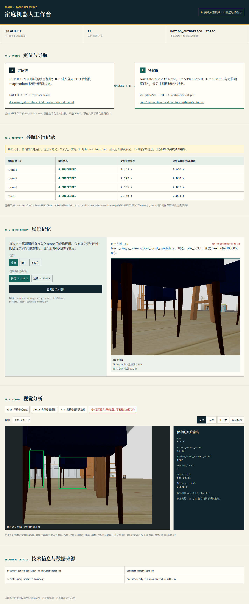

# soarm-car · 家庭服务机器人：自主导航与语义感知

以 **树莓派 5 + 麦克纳姆底盘 + Livox MID-360 + RGB-D 相机** 为平台的 ROS 2 Humble 全栈项目：从 URDF、Gazebo 仿真、ros2_control，到 FAST-LIO 定位、Nav2 导航、房间搜索、语义记忆和只读 Web 工作台。

整个项目由我主导设计与验收，日常开发与 Claude Code / Codex 等多个 AI Agent 协作完成：**我定目标、定边界、做评审，Agent 在各自的 worktree 里并行实现和实验**。这个仓库保留了完整过程：36 条分支、22 个检查点标签、每项实验的验收记录与失败记录。



## 成果一览

| 方向 | 做了什么 | 结果 / 证据 |
|---|---|---|
| 定位 | FAST-LIO 里程计 + 对固定 PCD 地图做点到点 ICP 全局校正，健康状态驱动 TF 融合与速度门控 | `docs/navigation-localization-implementation.md`（`integration/graduation-assistant`） |
| 导航 | Nav2 SmacPlanner2D 全局规划 + 全向 MPPI 局部控制 + `localization_cmd_gate` 失效即停 | 仿真中 room-1/2/3、mian 四个目标均 **SUCCEEDED**，定位终点误差 **0.14–0.17 m**（上图） |
| 故障分析 | 窄门处 map 系定位误差增长到约 **0.38 m**，导致规划反复失效；逐条排除速度、膨胀半径等假设，完成定位算法选型 | `docs/kuruma-blocked-goal-diagnosis.md`、`docs/kuruma-localization-algorithm-selection-plan.md` |
| 视觉定位 | 纯 RGB-D 基线：深度反投影、SVD（Kabsch）刚体拟合并裁剪离群、内点/残差/可观测性门控、关键帧重定位 | `ros2_ws/src/soarm_visual_localization`（`feature/dabai-dc1-visual-validation`） |
| 房间搜索 | 到房间扫描点原地四段旋转采集点云 → 提取保守桌面候选 → 结合占据栅格与 Nav2 路径可达性选停靠观察点 | `ros2_ws/src/soarm_room_search`、`docs/room-search.md`（`feature/room-search`） |
| 语义层 | 11 条观测的语义记忆（过期与冲突处理）；小型 VLM 裁剪识别 16 次实测，**发现编号敏感、未证实语义增益，如实记录** | `docs/semantic-memory.md`、`docs/research/vlm-crop-context-v1.md` |
| 下位机 | 核对 STM32F405 底盘协议：USART1 115200-8N1，帧 `AA 55 LEN CMD DATA CRC FE`，XOR 校验、心跳与模式切换先停车，设计 ROS 2 串口适配与 fail-closed 约束 | `WORKSPACE_INDEX.md`（`feature/dabai-dc1-visual-validation`） |
| 融合实验 | 不确定性感知的视觉 / 激光自适应融合包与消融脚本 | `ros2_ws/src/soarm_uaf_tm`（`experiment/uaf-fusion`） |

所有结论都尽量落到“代码入口 + 运行记录”。仓库里的状态接口在未接硬件时一律明确返回“未执行”，不伪造导航或抓取成功。

## 分支地图

默认分支 `main` 是早期的底盘与仿真基线。后续工作按“一条实验一个分支、一个 worktree”并行推进，主要分支如下：

| 分支 | 内容 |
|---|---|
| `integration/graduation-assistant` | **功能集成线**：导航恢复快照、命名地点请求、语义记忆、VLM 裁剪、只读工作台、语言导航意图网关 |
| `experiment/nav2-clean-baseline` | 可复用的自主导航基线（ros2_control 球轮底盘、FAST-LIO、Smac、全向 MPPI），多房间成功记录 |
| `experiment/reuse-nav-service` | 复用原导航消费者完成 room-1 → hub 往返；两次启动失败和最终成功都保留 |
| `feature/kuruma-rethink` → `feature/keyboard-teleop` → `feature/dabai-dc1-visual-validation` | 新底盘重构、键盘遥控、Dabai DC1 相机与 RGB-D 视觉定位 |
| `feature/room-search` | 找书桌并停靠观察的受限任务 |
| `experiment/semantic-memory`、`experiment/vlm-crop-context`、`research/vlm-grid-design` | 语义记忆、VLM 裁剪与语义栅格小试 |
| `experiment/frontier-core`、`experiment/exploration-*` | 先验地图辅助的前沿探索 |
| `experiment/intel-runtime`、`experiment/nvidia-exploration-runtime`、`experiment/sensor-pipeline` | 渲染后端与传感器管线排障 |
| `research/companion-*` | 家具住宅场景、已知位姿研究支线（含 ABORTED 记录） |
| `fix/fastlio-icp-drift`、`feature/nav2-*`、`feature/house-*`、`feature/hm3d-apartment-worlds` | 早期定位修复、导航与仿真场景 |
| `experiment/uaf-fusion` | 视觉 / 激光自适应融合 |

`checkpoint/*` 标签是每次高风险改动之前的回滚点，例如 `checkpoint/kuruma-before-localization-recovery`、`checkpoint/kuruma-planar-icp-stable`。

## 我是怎样和 AI Agent 协作的

1. **并行但不互相踩踏。** 每个实验独占一个 git worktree 和分支。`WORKSPACE_INDEX.md` 是一份所有 Agent 都要先读的“工作区合同”：每个 worktree 的职责和可复用入口；同一时刻只允许一个仿真所有者；不得修改其他 worktree 里别人未提交的文件；不推送、不操作实物。
2. **先有契约，再有实现。** 较大的任务先写验收契约（例如 `docs/research/intel-exploration-contract.md`、`docs/language-navigation-contract.md`），列出可以独立观察的验收项和停止条件，Agent 按契约实现，我按契约验收。
3. **可回滚。** 高风险改动前打 `checkpoint/*` 标签。实验失败不删除，失败原因和证据都留在 `artifacts/` 与 `docs/` 中，以后重新决策时可以直接查。
4. **诚实报告。** 未验证的能力不写进结论：VLM 没有带来可证实的语义增益，就写“未证实”；AWS 已知位姿支线失败，就标 ABORTED，并注明它不代表其他分支的导航失败。

## 快速开始

开发环境是 Docker 中的 ROS 2 Humble（Linux X11/XWayland，直通 `/dev/dri`）：

```bash
./scripts/dev-build.sh
./scripts/dev-gpu-check.sh     # 确认用的是真实 GPU，不是 llvmpipe
./scripts/dev-start.sh         # RViz2 + Foxglove Bridge
```

完整的开发、相机与仿真说明见 [docs/DEVELOPMENT.md](docs/DEVELOPMENT.md)。导航基线的启动入口在 `experiment/nav2-clean-baseline` 分支的 `scripts/run-nav2-clean-comparison.sh`。

## 目录

```text
ros2_ws/src/     自研 ROS 2 包：仿真、导航、房间搜索、视觉定位……
config/          任务与语音白名单策略
docs/            设计、调研、故障分析与验收文档
scripts/         开发容器、冒烟测试与数据处理脚本
artifacts/       实验证据（大体积原始包已在公开版中移除）
vendor/          第三方源码快照
```

## 公开版说明

- 公开前用 `git filter-repo` 统一了作者身份，移除了大体积证据包（>2 MB 的 tar/日志）、第三方网页存档，以及没有许可声明的 WHEELTEC 厂商包（`turn_on_wheeltec_robot`、`wheeltec_robot_msg`）。真实底盘驱动需要向厂商获取。
- 以 `chore: import uncommitted workstation work (snapshot 2026-09-28)` 开头的提交，是发布时各 worktree 中尚未提交的成果快照，导入后没有整体重新验证。
- `vendor/` 中保留的第三方代码遵循各自许可：FAST_LIO_LOCALIZATION_ROS2（BSD）、livox_ros_driver2（MIT）、serial_ros2（Apache-2.0）、ros2_astra_camera。
