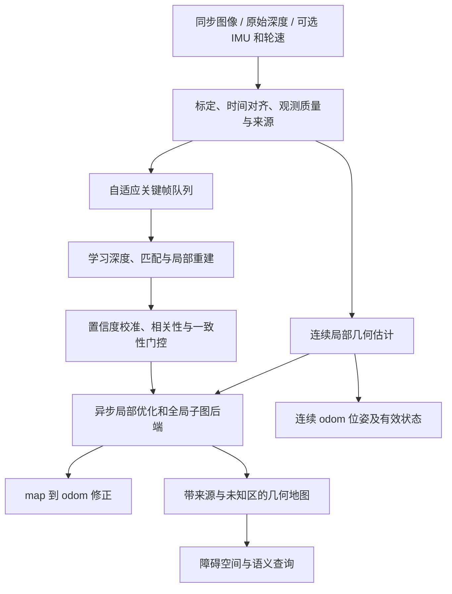

# 下一代机器人视觉：从 DC1 实测到几何与学习融合

研究截止：2026-09-15。范围：办公室移动机器人，单目、双目、RGB-D 定位与建图；依据为作者论文、官方代码和当前 worktree 的实验。**本文是研究与设计结果，文中前沿模型没有在本轮新增实测。** “已发布代码”不表示本机已复现；论文性能不表示本机器人性能。

## 1. 决策

建议采用 **连续几何定位 + 异步学习深度/重建 + 可校准的不确定性门控**。当前 DC1 保留为 RGB-D 基线；下一代硬件优先考虑经过标定、硬件同步的双目与 IMU，主动深度补充近场。是否升级硬件，应由校准后的故障归因决定，不能从两段短 bag 直接得出必须换相机的结论。

关键不是把更多算法的位姿平均，而是补充真正不同的约束：图像重投影、真实深度、惯性和轮速；同一图像派生的网络深度、光流、点图必须处理相关性。大模型在关键帧提供补充几何，实时控制使用具有明确失效状态的局部估计。这个结构是依据已有研究的工程取舍，不宣称原创。

优先级：先校准和建立真值 → DROID-SLAM / cuVSLAM RGB-D 对照 → 深度补全固定前端消融 → 双目惯性与多传感器验证 → 学习式稠密地图。不要同时改相机、同步、前端、后端和深度网络，否则无法解释收益来源。

## 2. 本机证据规定了什么边界

详见 [ORB-SLAM3 实验](../dabai-dc1-orbslam3-validation.md) 和 [12 次多算法实验](../dabai-dc1-rgbd-comparison.md)。两段办公室 bag 的唯一 RGB-D 配对分别 1275、740；无左右双目、IMU、轮速和轨迹真值。640×480 RGB 与 640×400 深度采用顶部裁剪假设，尚未完成独立几何验证；最近时间戳配对不代表曝光同步。

| 已实测对象 | 第一段 / 第二段 | 可支持的结论 |
|---|---|---|
| ORB-SLAM3 基线 OK 状态覆盖 | 65.57% / 87.84% | 当前输入下存在失跟与地图切换；不能推断全部有效位姿准确 |
| RGBDICP 正反向及深度一致性通过 | 98.35% / 97.56% | 光度与深度联合有候选互补；这是帧间筛查，不是完整 SLAM 准确率 |
| RGBDICP 隔帧采样通过 | 90.27% / 78.05% | 本数据保留短跨度更有利；不是越多时间跨度越好 |
| RTAB-Map 外部失跟重置策略有效输出 | 59.29% / 58.65% | 本次配置未解决连续性；不代表该算法一般水平 |
| 三算法保守主备选择 | 新增有效边 0 / 0 | 当前没有以额外计算换得已验证收益 |

上述指标定义不同，不能放在同一“精度榜”排序。RGBDICP 第二段最长连续通过只有 9.62 s，接近 98% 通过率也可产生碎片轨迹。ORB 地图合并时的坐标变化也不能直接当作真实瞬间运动。

2026 年的《Failure or Drift?》把失跟与继续输出时的漂移分开，发现受扰动时学习跟踪器可能持续输出但严重漂移；其主要证据来自户外测试，不能直接推广为办公室算法排名。该论文为 ECCV 2026 NeuSLAM **workshop**，不是主会论文。[论文](https://arxiv.org/abs/2608.30690)

## 3. 三种相机的真实差异

| 配置 | 尺度来自哪里 | 主要缺口 | 推荐角色 |
|---|---|---|---|
| 单目 | 纯视觉几何存在整体尺度自由度；网络可给统计尺度先验 | 纯旋转、弱视差、模糊、域外物体尺寸；模型自信不等于尺度可靠 | 低成本对照、语义与重定位、深度先验；单独承担米制定位需专门验证 |
| 已标定同步双目 | 已知基线与视差建立米制几何 | 遮挡、重复/弱纹理、远处小视差、同步及外参误差 | 下一代几何主干候选；IMU 补短时运动约束 |
| RGB-D | 深度传感器测距与标定 | 无效孔洞、边缘混合、反射/透明表面、环境光与量程影响；具体表现依传感器原理 | 当前 DC1 路线及近场障碍几何；有效性掩码不可丢失 |

双目理想模型为 z = fb/d，因此 σz ≈ z²σd/(fb)：距离变远会迅速放大视差误差。例：f=500 px、b=0.10 m、σd=0.5 px 时，2 m 约 4 cm，5 m 约 25 cm；这是独立于某款相机的误差传播示例，不是 DC1 规格。扩大基线还会增加近场遮挡与安装代价。[标定与三维重建接口](https://docs.opencv.org/4.x/d9/d0c/group__calib3d.html)

IMU 并不使所有运动都可观测：时间偏差、偏置、缺乏激励仍可能妨碍尺度估计。轮速也会打滑。需要检验各自失效模式，而不是把“多传感器”当可靠性的充分条件。Scalix 也明确讨论恒速等条件下的尺度问题。[Scalix](https://arxiv.org/abs/2608.17553)

## 4. 前沿证据：按解决的问题选算法

### 4.1 连续定位与完整 SLAM

| 方法 | 核验状态与作用 | 对本项目的价值及限制 |
|---|---|---|
| DROID-SLAM | 官方代码支持单目、双目和 RGB-D | 优先 GPU 学习式定位对照；必须报告实际跟踪状态、回填轨迹、全局优化成本，不能仅看导出的稠密轨迹 |
| cuVSLAM 当前版本 | 官方仓库已有源码构建；Mono、RGBD、多相机、双目惯性模式 | 直接进入 DC1 RGB-D 候选；Multisensor 的 RGB-D+IMU 路径明确为实验性，不能视同成熟默认路径 |
| MASt3R-SLAM | CVPR 2025，作者代码与模型下载入口可用 | 点图先验驱动的稠密 SLAM 对照；模型预测的尺度与传感器尺度必须分别验证 |
| VGGT-SLAM 2.0 | 作者仓库记载 RSS 2026 接收；2.0 代码可用 | 子图式学习重建与全局关联候选；建图更新周期不等于逐帧低延迟位姿能力 |
| DROID-W | CVPR 2026 官方论文入口；动态场景视觉一致性研究 | 人员走动时的重点候选；先验证作者环境与公开代码复现，再讨论本机收益 |

主源：[DROID-SLAM](https://github.com/princeton-vl/DROID-SLAM)、[cuVSLAM](https://github.com/nvidia-isaac/cuVSLAM)、[MASt3R-SLAM](https://github.com/rmurai0610/MASt3R-SLAM)、[VGGT-SLAM 2.0](https://github.com/MIT-SPARK/VGGT-SLAM)、[DROID-W 官方论文](https://openaccess.thecvf.com/content/CVPR2026/html/Li_DROID-SLAM_in_the_Wild_CVPR_2026_paper.html)。本节列出候选，不按跨论文 ATE 或 FPS 排名。

### 4.2 有传感器深度时：补全优先于完全替代

| 方法 | 当前公开证据 | 拟测试问题 |
|---|---|---|
| Prior Depth Anything | ICLR 2026；代码与预训练入口公开 | RGB 与部分深度联合，能否补孔洞且保留真实米制结构？ |
| Any2Full | 作者仓库标 ECCV 2026；代码与模型入口公开 | 一阶段深度补全能否改善时延与下游定位？ |
| MetricAnything | 作者仓库标 ECCV 2026；两个无提示 student 公开，提示式 teacher 仍 Coming Soon/TBD | student 可做纯单目尺度对照；不能把未发布 teacher 列入可立即复现的 DC1 补全实验 |
| Depth Anything 3 | 图像/多视图几何、单目与米制分支，代码公开 | 单目、多视图及流式重建对照；固定具体变体，不能用一个名称混合比较相对深度和米制模型 |

来源：[Prior Depth Anything](https://github.com/SpatialVision/Prior-Depth-Anything)、[Any2Full](https://github.com/zhiyuandaily/Any2Full)、[MetricAnything](https://github.com/metric-anything/metric-anything)、[Depth Anything 3](https://github.com/ByteDance-Seed/depth-anything-3)。DA3 官方建议使用修复训练问题后的相关 1.1 checkpoint；实验必须记录精确版本。

DC1 的有效测量不能默认全部准确。补全前须识别边缘混合、量程外与时间错位；至少输出 measured / predicted / invalid 三类来源。填得更满、更平滑不等于定位更准，更不等于可通行空间已被测量。不能把一张补全图当作数万个新的独立测距。

### 4.3 双目：现在值得认真验证的学习匹配

Fast-FoundationStereo（CVPR 2026）官方在 RTX 3090、640×480 上报告 TensorRT 14.0–23.4 ms，取决于 checkpoint 与迭代次数；同配置族 PyTorch 为 29.3–49.4 ms。这只是匹配模型计时，不含相机传输、整流、定位和规划，也不是 Pi 5 或现有 GPU 的测量。FoundationStereo 可作为离线质量对照。[Fast-FoundationStereo](https://github.com/NVlabs/Fast-FoundationStereo)、[FoundationStereo](https://github.com/NVlabs/FoundationStereo)

现有 bag 只有 RGB 与深度，**不能直接运行真正的双目匹配验证**。把相邻时刻 RGB 当左右目会引入未知运动和动态物体；把深度反投影成右图再恢复深度只是自洽测试，不是独立算法证据。必须使用真实同步左右图、基线、整流参数和真值。

### 4.4 2026 年最值得借鉴的结构变化

| 研究方向 | 主源 | 应借鉴什么；不应推断什么 |
|---|---|---|
| 显式尺度与不确定性 | [Scalix，2026-08 预印本](https://arxiv.org/abs/2608.17553) | 将每像素深度与每帧尺度不确定性分开；代码在论文中仍承诺接收后发布，当前按设计参考处理 |
| 概率化深度先验 | [PRISM-SLAM，2026-05 起预印本](https://arxiv.org/abs/2605.19257) | 概率因子与异步先验；论文的实时主张需要同硬件复现，不能自动转成板端能力 |
| 定位与基础模型建图分离 | [ScaRF-SLAM](https://ori-drs.github.io/projects/scarf-slam/)、[论文](https://arxiv.org/abs/2606.00307) | 几何定位提供连续性，前馈模型提供稠密结构，维护子图尺度与闭环一致性；不能只拼接漂亮点云 |
| 灵活条件输入 | [MapAnything，3DV 2026](https://github.com/facebookresearch/map-anything) | 可输入图像、标定、深度、位姿组合，适合研究条件化融合；属于重建框架，不自动具备完整导航 SLAM 的恢复与健康管理 |
| 长序列流式几何 | [LingBot-Map](https://github.com/Robbyant/lingbot-map)、[VGGT-Ω](https://arxiv.org/abs/2605.15195) | 跟踪上下文、记忆和前馈三维能力的发展；流式处理、大场景演示不是无漂移或米制精度证明 |

FoundationSLAM（AAAI 2026）也是基础模型与几何优化融合的已发表参考，说明此方向已有系统研究；不能把“基础模型加 BA”本身作为创新点。[AAAI 原文](https://ojs.aaai.org/index.php/AAAI/article/view/38061)

## 5. 推荐系统结构

这是待验证设计，尚未实现。第一版不自研完整 SLAM：先选一个官方可复现主干，在适配与评估层保持一致；因子级修改只在明确证据表明需要时进行。

### 快慢路径及接口

局部视觉路径以 30 Hz 为初始设计目标，若 IMU 可用则另行高频传播；关键帧学习推理与全局图优化异步调度。频率是待测预算，不是现有性能承诺。时间戳以曝光/测量时间为准，另记到达、处理开始、发布时刻，统计端到端 p95/p99 和积压。

每个观测至少携带 frame_id、calibration_id、capture_time、source、valid_mask；每个估计带 map_epoch、状态、使用的观测范围、延迟与不确定性。延迟到达的深度因子关联原关键帧，过期则丢弃或重算，不能假装来自当前帧。历史状态被边缘化后，新增先验如何处理必须由所选后端定义。

保持 odom 局部连续，闭环更新 map→odom。切换估计器或重建子图时不得把未知坐标变换默认为单位变换。失败状态要显式传给消费端；禁止通过插值、平滑或重置计数隐藏失效。

### 地图用途分离

定位用稀疏/半稠密几何；近场避障用带未知区的占据、TSDF/ESDF 等表示；可视化可用点云或 Gaussian Splatting。渲染逼真不证明碰撞几何正确。学习补出的表面不能单独证明其前方/后方是自由空间；动态物体应维护时效，而不是永久融合进静态地图。

语言与开放词汇语义用于目标查询及候选解释，不把“看起来像门/桌子”的描述作为无条件几何约束。与当前任务无关的通用视觉语言大模型训练不列为第一阶段工作。

## 6. 多种采样如何真正融合

### 空间采样：补约束方向，不只追高梯度

在固定计算预算下混合图像角点/梯度、深度边缘、不同平面法向、近远深度以及空间网格覆盖。可用局部信息矩阵 Λ = Σ JᵀWJ 的增益近似挑点，同时限制高度相关区域重复入选。比较特征值前必须归一化旋转与平移尺度，否则条件数可能没有物理意义。

平面上的大量 ICP 点仍无法约束平面切向运动；增加同方向样本不会补上缺失维度。重复纹理中密集光度采样也可能共同匹配错误。信息/可观测性引导选点已有前人工作，应作为基线而非原创声明。[Good Features to Track for Visual SLAM，CVPR 2015](https://openaccess.thecvf.com/content_cvpr_2015/papers/Zhang_Good_Features_to_2015_CVPR_paper.pdf)

### 时间采样：短边维持跟踪，长边提供有条件约束

保留相邻帧短边；在视差、旋转、可见静态结构与模型预算合适时加入长边。长边主要价值是尺度/结构和漂移约束，不应以丢掉短边为代价。现有隔帧实验已经提供反例。每条边携带来源帧集合；相同图像的短边与长边不按独立测量简单相加。

### 观测融合：模型分歧是诊断信号

优先在残差/因子层融合，而非平均各算法输出。若必须在轨迹层融合，先处理坐标、时间、重置、偏置和相关性；缺少可信协方差时只做候选选择及健康检查，不伪造小协方差灌入滤波器。

一个说明性尺度模型：若同帧深度 d 共享随机尺度 s，近似协方差含 σs² ddᵀ + s²Σd。第一项表示跨像素相关；忽略它会把重复信息当成精度提升。该形式还依赖尺度与深度误差独立等近似，真实系统应校准验证。[Scalix 全文](https://arxiv.org/html/2608.17553v1)

网络 confidence 应在独立数据上检查“置信度越高是否确实误差越低”，再转成权重；不能把任意分数直接解释成概率。透明物体、白墙、模糊、时间错配需分别统计，而不是只算全数据平均。

## 7. 可执行验证路线与淘汰条件

详细逐组实验见 [实验矩阵](next-generation-visual-experiments-20260915.md)。所有新组均为计划，未混入此前实测。

1. **修复证据基础。** 测 RGB/深度投影、裁剪及 K 一致性、单位、静止深度误差、运动时间偏差。重新录制已知位移与回到原点，以及有外部轨迹参考的长序列。仅起终点约束不能替代全程真值。
2. **固定输入比较主干。** 复跑 ORB、RGBDICP、RTAB，对照 DROID RGB-D 和 cuVSLAM RGB-D；另做同一 RGB 的单目模式。公共 TUM RGB-D 等带真值数据先验收适配，再跑办公室。CPU/GPU、分辨率、初始化、恢复策略均记录。
3. **只改变深度来源。** 原始深度、确定性滤波、Prior DA、Any2Full；先固定真实/参考位姿检查几何，再固定前端检查定位。进行测量点留出，避免把作为模型输入的深度又用作唯一“真值”。
4. **再验证新观测和全局地图。** 有真实同步双目/IMU 后测试匹配与 VIO；有轮速后加入打滑场景。MASt3R/VGGT/MapAnything 作为独立研究分支，最后才测试子图融合。
5. **只保留可解释收益。** 相同数据、预算和阈值下评估失败率、失效时长、错误高置信度率、米制误差、重定位恢复与资源。若只改善渲染或状态覆盖而恶化真实漂移，应淘汰或限定用途。

评估使用全序列时间基准，分别报告初始化前、丢帧、失跟、重置、未关联真值区间。ATE/RPE 同时记录覆盖率；米制方法以 SE(3) 对齐为主，单目另报告 Sim(3) 结果和尺度漂移，不能用真值尺度对齐掩盖米制错误。每组至少 5 次作为初步稳定性检查，确定性算法的重复运行主要检查时延与执行稳定性，不伪装成独立样本。

重点场景：白墙/长走廊的几何退化；原地旋转/急转的同步与模糊；人员遮挡/搬椅子的动态；玻璃/显示屏的异常深度；重复回访与闭环。人工合成扰动只能补充真实录制。

使用 [VSLAM-LAB](https://github.com/VSLAM-LAB/VSLAM-LAB) 借鉴统一输入、版本和评估；多模态退化参考 [Ground-Fusion++ / M3DGR](https://arxiv.org/abs/2507.08364)。不需要第一轮就重造全部测试框架。

## 8. 算力、版本和可复现门槛

已有 CPU 耗时来自 Core Ultra 7 255H，不能外推 Pi 5。研究 GPU 与车载算力分开：先在可用 GPU 测算法价值，再以实际峰值内存、端到端延迟、功耗和温度决定部署。24–48 GB 只是重模型研究的可选预算范围，不是已证明的最低规格，也不是采购建议。旧 GPU 的精度格式、注意力内核、CUDA 扩展需单独验证，显存容量不能替代兼容性。

模型清单固定 repo commit、checkpoint 哈希、预处理、内参变化、深度约定（光轴 z 或沿射线距离）、精度格式、依赖/驱动和许可证。冷启动与预热后运行分开记录。代码已开源、权重已发布、可商用、可实时是四个不同问题。

| 项目 | 已核验的版本/许可注意点 |
|---|---|
| cuVSLAM | NVIDIA Community License；默认与实验模式分别记录，不从旧发布介绍推断当前源码能力 |
| Fast-FoundationStereo | 研究 checkpoint 与 C-Fast-FoundationStereo 商业路线分开，后者还指向 TAO 的相应代码 |
| MapAnything | 代码 Apache-2.0；默认与 apache 模型分别为 CC-BY-NC 4.0 / Apache-2.0，不能只看仓库 LICENSE |
| VGGT-SLAM / MASt3R-SLAM | SLAM 代码与所依赖基础模型权重分别核验；代码许可不能覆盖模型许可 |
| Depth Anything 3 / MetricAnything | 固定具体模型变体；DA3 注意 1.1 修复，MetricAnything 不把未发布 teacher 视为已有模型 |

许可与发布依据为以上各方法官方仓库当前页面；真正部署前固定版本并保存对应许可证。本文未完成所有依赖的逐项许可审计。

## 9. 值得做成研究问题的三个假设

**H1：带来源与尺度不确定性的深度补全能否降低错误高置信度？** 对照原始深度、直接替换补全图、仅填洞、相关性建模四种方式；以米制误差与错误接受率为主。若只有孔洞率/画面好看改善，假设不成立。

**H2：固定预算的信息方向采样能否比均匀采样更稳定？** 比较均匀、梯度、深度结构和信息增益混合，保持点数或实际耗时一致，白墙与旋转分开报告。不能用更多点、更多算力解释为采样创新。

**H3：异步基础模型先验能否改善弱纹理而不破坏连续性？** 对照纯几何、同步逐帧网络、异步关键帧网络；注入推理延迟与过时输出，记录真实端到端误差和可用时长。ScaRF-SLAM、Scalix、PRISM-SLAM 是相关基线，结构本身不是新颖性保证。

推荐先完成 H1，因为它最贴近现有 DC1 可用数据和已发现的光度/深度互补；随后 H2。H3 成本更高，应在前两项证明数据与评估可信之后投入。还不能给出“下一代算法已胜过 ORB-SLAM3”的结论。
